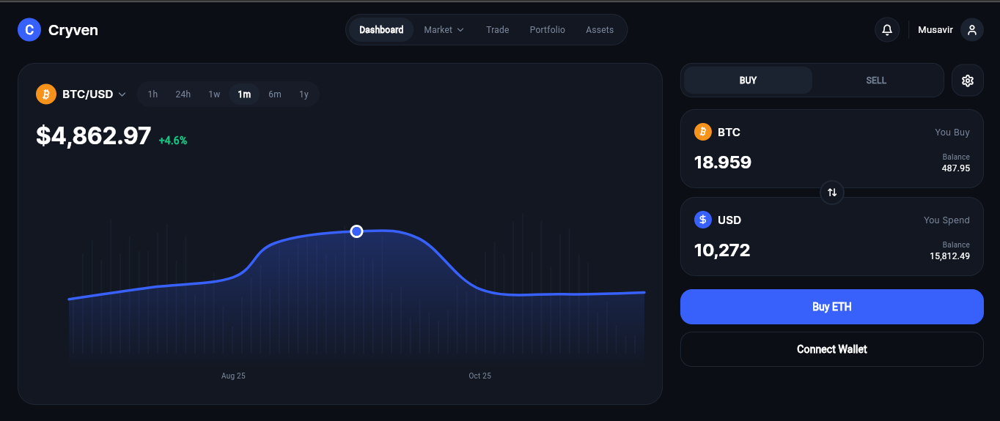
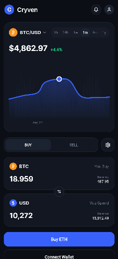

# 📈 Cryven — High-Performance Crypto Trading Terminal

> A modern, futuristic crypto trading platform and portfolio management terminal designed with high visual fidelity, 60 FPS fluid chart rendering, and an adaptive layout engineered for desktop, tablet, and mobile browsers.

---

### 🚀 Live Demonstration
Experience the production web build live in your browser:  
🔗 **[Launch Cryven Terminal](https://cryven-crypto-dashboard.vercel.app/)**

---

## 📸 Interface Preview

| Desktop Dashboard | Mobile Adaptive View |
|:---:|:---:|
|  |  |

---

## ⚡ Core Technical Highlights

- **Custom Graph Engine:** Interactive financial line chart engineered with `fl_chart`, featuring custom glow gradients, animated dot indicators, and background vertical frequency volume bars rendered using Flutter's `CustomPainter`.
- **Ultra Responsive Breakpoint Matrix:** Custom-built layout resolver (`ResponsiveBuilder`) adapting seamlessly across desktop displays (multi-column), tablets, and mobile viewports with horizontal scroll safety.
- **Micro-Interactions & Fluidity:** Animated selection pills, dynamic time-filter toggling (1h, 24h, 1w, 1m, 6m, 1y), and bidirectional currency swapping.
- **Clean Architecture & Scalability:** Strict separation of UI presentation, data models, typography systems, and domain constants for enterprise-level maintainability.

---

## 🛠️ Tech Stack & Dependencies

* **Framework:** Flutter (Web, iOS, Android)
* **Language:** Dart 3.x
* **Chart System:** `fl_chart` & `CustomPainter`
* **Icons:** `lucide_icons`
* **Typography:** `google_fonts` (Inter)
* **Hosting & CI/CD:** Vercel Global Edge Network

---

## 📁 Architectural Structure

    lib/
    ├── core/
    │   ├── constants/
    │   │   ├── app_colors.dart       # Deep dark fintech design palette
    │   │   └── app_typography.dart   # Standardized type scale
    │   └── utils/
    │       └── responsive.dart       # Screen breakpoint resolver
    ├── models/
    │   └── crypto_asset.dart         # Financial asset contracts & mock engines
    ├── views/
    │   ├── dashboard_view.dart       # Master viewport layout
    │   └── widgets/
    │       ├── top_nav_bar.dart      # Adaptive header & profile tray
    │       ├── main_chart_card.dart  # 60fps glow chart + volume painter
    │       ├── quick_trade_card.dart # Buy/Sell order execution terminal
    │       ├── balance_card.dart     # Neon radial vault card
    │       └── asset_table.dart      # Live asset ticker matrix
    └── main.dart

---

## 🎨 Design & Attribution

- **Original UI/UX Concept:** Inspired by [Cryven - Crypto Dashboard UI Design](https://dribbble.com/shots/26749742-Cryven-Crypto-Dashboard-Dark-Mode-Trading-Wallet-UI-Design) on Dribbble.
- Re-architected and engineered into production-ready Flutter code by **Syed Musavir Ali Shah**.

---

## 👨‍💻 Engineer & Contact

**Syed Musavir Ali Shah**  
*Flutter & Mobile Application Engineer*
- **Email:** musavir.ali717@gmail.com
- **LinkedIn:** https://www.linkedin.com/in/syed-musavir-ali-shah-156b2422b/
- **Location:** Karachi, Pakistan